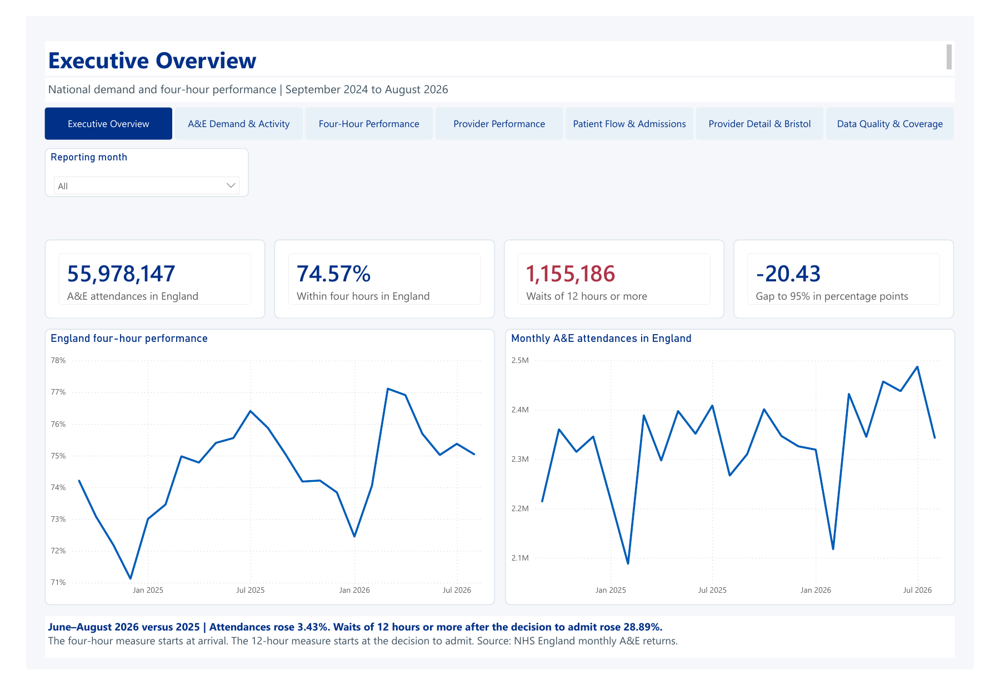

# NHS A&E performance and patient flow in England

How much did emergency-care pressure change, which providers warrant a closer look, and how much of the comparison can the published data support? I used 24 monthly NHS England returns from September 2024 to August 2026 to answer those questions. This is an independent portfolio project.

**55,978,147 attendances · 74.57% within four hours · 1,155,186 waits of 12 hours or more after the decision to admit**

## What I found

- **Long waits rose faster than demand.** Comparing June–August 2026 with the same months in 2025, England attendances rose **3.43%**, while waits of 12 hours or more after the decision to admit rose **28.89%**. I would review these measures together using matching calendar periods. The four-hour clock starts at arrival. The long-wait clock starts at the decision to admit.
- **Mid and South Essex is a case for investigation.** Its weighted Type 1 four-hour rate fell **9.29 percentage points** while unbooked Type 1 attendances fell **7.13%**. Long waits rose from **733 to 3,660**. I would verify reporting scope and review the admission pathway with local teams before attributing a cause.
- **Reporting history matters when comparing providers.** Of **112** eligible provider keys, **37** had worse Type 1 rates in all three matched months and **27** improved in all three. I required positive activity across all 24 months and a consistent reported name within each key. The Bristol merger is handled explicitly so a change in footprint can be distinguished from a change in performance.

The figures use a frozen extract. Later publication revisions and the limits of provider comparisons are documented alongside the analysis. [Methods, definitions and findings](docs/reporting_methodology.md) · [Source versions and attribution](docs/data_sources.md)

## Explore the seven report pages

| Report page | Question it answers |
|---|---|
| [Executive Overview](assets/powerbi/executive-overview.png) | How do England demand, four-hour performance and long waits move over time? |
| [A&E Demand & Activity](assets/powerbi/ae-demand-and-activity.png) | How do activity and long attendances vary by department and month? |
| [Four-Hour Performance](assets/powerbi/four-hour-performance.png) | How does a provider’s weighted Type 1 rate compare with England for the same months? |
| [Provider Performance](assets/powerbi/provider-performance.png) | Which provider gaps warrant review once reporting history is taken into account? |
| [Patient Flow & Admissions](assets/powerbi/patient-flow-and-admissions.png) | How do Type 1 admissions and provider-wide waits after the decision to admit change over time? |
| [Provider Detail & Bristol](assets/powerbi/provider-detail-and-bristol.png) | How does the selected provider vary by month, and what does the merger-adjusted Bristol series show? |
| [Data Quality & Coverage](assets/powerbi/data-quality-and-coverage.png) | Which reporting histories are complete, and where are returns or comparable records missing? |

These images are exports of the actual Power BI Desktop report. The two provider examples show Airedale. For interactivity, download or clone the entire repository and open [NHS_Hospital_Performance.pbip](powerbi/NHS_Hospital_Performance.pbip) in Power BI Desktop for Windows. In **Home → Transform data → Edit parameters**, set `SnapshotPath` to the absolute path of [the supplied CSV](data/processed/ae_reporting_monthly.csv), leave `SqlServerName` blank, select **OK**, then **Apply changes** and refresh. Use the page tabs or Ctrl-click the canvas navigation buttons in edit mode. The month and provider dropdowns are local to their pages. Clear selections in each dropdown. Hover over a chart point for the built-in tooltip. [Desktop interaction checks](docs/powerbi_refinement_review.md)

## How I built and checked it

I load the monthly returns into SQL Server with Python, retaining the filename and source row number. The [typed reporting view](sql/18_create_ae_reporting_view.sql) normalises reporting months, safely converts counts and separates published England totals from provider records. The [England analysis](sql/20_england_ae_activity_and_performance.sql) uses window functions for weighted rolling rates, and the [provider analysis](sql/21_comparable_provider_pressure.sql) joins each month to the same month of the previous year.

The Power BI import model uses separate provider and England fact tables. Month filters both, and organisation filters the provider fact. DAX divides total attendances within four hours by total attendances in scope, using a blank where the denominator is zero. In Desktop I verified that selecting Airedale returned **59.49%** while the England Type 1 benchmark held at **60.03%**.

I reconciled **4,751** rows and all **432** monthly provider-to-England measure totals. The live view matched the CSV snapshot across all 22 shared fields. A separate Desktop test refreshed directly from SQL Server and matched the executive KPIs and provider-filter checks. [SQL validation script](sql/19_validate_ae_reporting_view.sql) · [Validation evidence](docs/validation_and_portfolio_review.md)

| Folder | Contents |
|---|---|
| [data](data) | Frozen monthly NHS England files and validated report snapshot |
| [python](python) | Source inspection, SQL loading, snapshot generation and independent validation |
| [sql](sql) | Database setup, validation queries, reporting view and analytical outputs |
| [powerbi](powerbi) | Power BI project, report definitions and semantic model |
| [assets/powerbi](assets/powerbi) | Seven full-page report exports |
| [docs](docs) | Source manifest, technical setup, methodology and acceptance evidence |

[Reproduction steps](docs/reproduce.md) · [Script and business-question audit](docs/project_audit.md) · [Interview walkthrough](docs/interview_study_guide.md) · [GitHub release review](docs/github_release_review.md)
